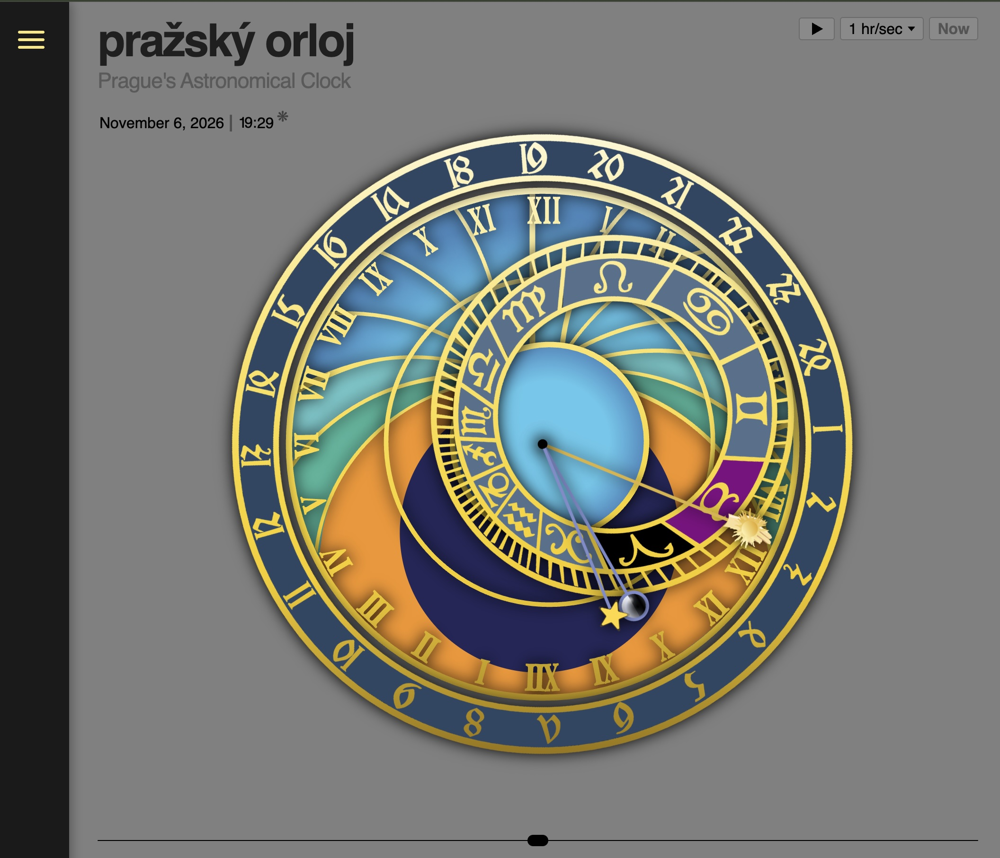

# pražský orloj



A digital recreation of the Prague Orloj — the medieval astronomical clock on Prague's Old Town Hall — built as layered, animated SVG graphics in React.

## About the Prague Orloj

The Prague Orloj (built starting 1410, the oldest astronomical clock still running) is really three independent machines stacked on one wall. Understanding them separately is the key to modelling it — they don't share a clockwork logic, they just share a facade.

### The Astronomical Dial (the upper face)

This is the heart of it and where most people get lost. It is not a clock face with extra decoration — it's a mechanical astrolabe, a flat stereographic projection of the sky as seen from Prague's latitude. The clever part is that a single moving Sun hand lets you read four different time systems at once, because each system is just a different ring it crosses:

- **Civil time (Roman numerals)** — the fixed black ring with I–XII twice around. Ordinary 24-hour time; you read where the golden Sun hand points. This is the only system most modern viewers recognise.
- **Old Bohemian / Italian time (the gold Gothic ring)** — the outermost ring of ornate Schwabacher numerals running 1–24, where hour 24 always lands at sunset. Because sunset drifts through the year, this entire ring is geared to rotate slowly, so the "24" position tracks the seasons.
- **Babylonian / unequal hours (the curved gold arcs)** — these split the daylight portion into 12 equal parts. Since daylight is longer in summer, a "Babylonian hour" is physically longer in July than in December. These arcs only exist inside the blue day-disk.
- **Sidereal / star time and the zodiac** — the off-centre zodiac ring rotates roughly once per sidereal day and shows which constellation the Sun is sitting in. Its eccentric (off-centre) placement is a direct consequence of the stereographic projection — that off-centredness is what makes the geometry look intimidating.

Layered on top of those rings are the moving indicators: the Sun hand (whose tip rides along the zodiac ring), the Moon hand with a half-silvered rotating sphere that physically turns to display the current lunar phase, and the static background plate showing the blue day sky, the orange dawn/dusk twilight bands (ORTVS/OCCASVS), and the black night zone (NOX) below the horizon.

The useful insight for this build is that this whole face is mathematically generated, not artistic: given a latitude (~50°N), the tropics, equator, horizon and twilight curves all fall out of standard astrolabe projection formulas. The ring positions can be computed from the date/time rather than hand-placed.

## The moving arms: construction and rotation

Three indicators rotate around the shared pivot `(600,600)`: the **Sun arm**, the **Moon arm**, and the **Star (sidereal) arm**. Each is its own SVG file/layer (`sun_dial.svg`, `moon_dial.svg`, `star_dial.svg`) rather than one shared drawing, because each turns at a genuinely different, independent rate:

| Arm | Period | Drives |
|---|---|---|
| Sun | ~24h00m (solar day) | Civil time (Roman ring), Old Bohemian time (numeric ring) |
| Moon | ~24h50m (lunar day) | Moon's position; angular gap vs. Sun gives lunar phase |
| Star / zodiac ring | ~23h56m (sidereal day) | Sidereal time; also the zodiac ring's own slow rotation |

Our rotation mechanism applies exactly one CSS `rotate()` value to an entire layer, so anything that needs to point at a genuinely different angle at a given moment *has* to live in its own layer — there's no way to spin part of one SVG independently of the rest of it. That's also why the Sun's little pointing hand (the *zlatá ručička* / manicule, reaching out to the outer numeral rings) is just extra artwork baked into `sun_dial.svg` rather than a fourth rotating layer: it's rigidly bolted to the Sun arm at a fixed radius and always shares the Sun's exact angle, so it comes along for free whenever the Sun arm rotates.

**Radius isn't always fixed either.** The zodiac ring is deliberately drawn off-center (eccentric) from the shared pivot — real astrolabe geometry, not a mistake (see `zodiac_ring.svg`, whose own center sits noticeably away from `(600,600)`). In the real Orloj, the Sun and Moon icons ride a peg that's constrained to the (rotating) eccentric zodiac ring, so their distance from the pivot slides in and out over the year even while their angle is driven by time-of-day.

**The Sun icon's radial slide is now built** (`sunGlyphRadius.ts`), the Moon's is not yet. The zodiac ring's outer decorative border (measured directly from `zodiac_ring_separated.svg`) is a circle centered at `(714.12, 600.06)` with radius ~269.5 — about 114 units off the shared pivot. Since the pivot sits inside that circle, a ray cast outward from the pivot at any angle crosses the ring's boundary exactly once; solving for that crossing distance gives the radius the Sun glyph should sit at. The angle used for that ray is the Sun hand's angle expressed in the *ring's own unrotated frame* (`zodiacHouses.angleInRingFrame` — the same "which house is the Sun over" math already used for house highlighting), which is why this works out to a rotation-invariant radius: it can be computed once in the ring's local frame and then applied directly at the Sun hand's actual on-screen angle. Mechanically, `sun_dial.svg`'s sun glyph (`#sun-glyph`, disc + rays — distinct from the *zlatá ručička* manicule reaching to the outer numerals, which stays fixed) is inlined via `GradientClockLayer`'s `decorate` hook (see `SunDialLayer.tsx`) and repositioned at runtime with a `translate()` along its own local vertical axis, rather than baked into the static artwork at one radius. Same visual payoff as the ring rotating underneath it: over a year, the glyph now visibly slides in and out (roughly 155–383 units from the pivot) rather than sitting still — most noticeable when scrubbing/playing through months quickly via the timeline. The Moon icon still sits at its old fixed radius; that's the remaining natural next layer of complexity.

**Rotation status today — all live:**
- **Sun arm** — `sunHandRotationDegrees()`. `degrees = fractionalHour × 15` (15°/hour; the doubled I–XII Roman ring has 24 numeral positions around 360°). At 0° the arm's unrotated artwork already points straight down toward the fixed ring's bottom XII (midnight); 180° flips it to point up at the top XII (noon).
- **Moon arm** — `moonHandRotationDegrees()`. Rather than simulating the ~24h50m lunar-day rate directly, it's derived as `sunAngle − lunarPhaseAngle`, where the phase angle comes from a real reference new moon (2000-01-06 18:14 UTC) and the actual mean synodic month (29.530588861 days). At new moon the Moon sits exactly on the Sun; at full moon, exactly opposite — anchored to today's real phase, not an arbitrary starting alignment.
- **Star arm & Zodiac ring** — `siderealRotationDegrees()`, shared by both since they're one physical motion. Uses the real GMST (Greenwich Mean Sidereal Time) formula plus Prague's longitude, *not* a made-up rate. See "What the Star arm shows" below.
- **Numeric ring** — `numericRingRotationDegrees()`. Computes Prague's actual sunset time for today (solar-declination/hour-angle formula, latitude 50.0755°N, DST-safe civil-hour conversion) and rotates the ring so its "24" mark — which sits at 105° in the artwork's unrotated baseline — lands exactly where the Sun arm will be at sunset.
- **Roman ring** — never rotates. It's the fixed reference bezel every other hand/ring reads against.

**What the Star arm shows.** The Sun hand tracks *solar* time (a day = the Sun returning to the same spot in the sky, 24h00m). The Star hand tracks *sidereal* time — a day measured by Earth's rotation relative to the distant, effectively-fixed stars, ~23h56m4s, about 4 minutes shorter. It's read on the exact same ring, the same way — it's just a second hand ticking at a very slightly different rate. Because that rate is ever so slightly faster than the Sun's, the Star hand slowly pulls ahead of the Sun by about 4 minutes (~1°) every day, sweeping through a full 360° lap relative to the Sun once a year. That growing gap is mechanically *why* the Star arm and the eccentric Zodiac ring share one rotation and drift together relative to the fixed Roman ring — the gap itself is effectively a slow, continuous "time of year" signal, the same way the Sun–Moon gap encodes lunar phase. Practically: the Star marks which point of the sky (and which zodiac constellation) is currently crossing due south over Prague, as opposed to the Sun hand, which marks civil time. One honest caveat: its *zero* position is anchored to a standard convention (LST 0h — the vernal equinox point on the meridian) rather than a fixed reference ring like the Sun has, since nothing else in the artwork pins down that absolute alignment. The rotation *rate* is exact real astronomy either way.

**Gradient-bearing rings and counter-rotation.** `gold-trim`, `roman-ring`, `center-ring`, `zodiac-ring`, and `numeric-ring` all carry the same vertical white → pale-yellow → warm-gold → bronze gradient. Because a plain `` can't be reached into at runtime, those five are rendered by `GradientClockLayer` instead of `ClockLayer` — it fetches the raw SVG and inlines it into the DOM so a `useLayoutEffect` (not a plain `useEffect` — it must land in the same paint as the layer's own rotation, or there's a one-frame flicker) sets the `<linearGradient>`'s `gradientTransform` to the *inverse* of the layer's rotation. The result: the ring artwork rotates normally, but the gold gradient always reads top-to-bottom on screen, never tilting with the ring. One real gotcha we hit: the `{ __html: markup }` object passed to `dangerouslySetInnerHTML` must be memoized (`useMemo`) — a fresh object every render made React reassign `innerHTML` on every re-render (e.g. every second, from the live clock tick), silently recreating the `<linearGradient>` element and erasing whatever `gradientTransform` had been applied to the previous one. Invisible on layers whose rotation also changes every render (the reset and the fix landed in the same commit), but it left `numeric-ring` — whose rotation is stable second-to-second — stuck showing the raw, un-rotated gradient a moment after each mount.

## Zodiac house highlighting

The zodiac ring's background is split into 12 wedges (one per sign), and each wedge can be recolored at runtime to show which sign a hand currently sits over: **Sun → purple, Moon → black, Star → red**. If two hands land in the same house at once, Sun beats Moon beats Star (a fixed priority, not a color blend).

**The math** lives in `src/clock/zodiacHouses.ts`, and mirrors how `numericRingRotationDegrees` compares a fixed baseline against a live angle:
```
angleInRingFrame(handDeg) = normalizeDegrees(180 + handDeg − ringRotation)
```
applied to each of `sunHandRotationDegrees`, `moonHandRotationDegrees`, and `siderealRotationDegrees` (for the Star), then bucketed into one of 12 `{sign, startDeg, endDeg}` ranges. A real, if easy to miss, consequence: since the Star and the zodiac ring share one rotation value, the Star's angle-in-ring-frame is a **constant 180° forever** — it always highlights the same house (Pisces, in this artwork). Not a bug — a direct result of them being rigidly linked.

**Where the house boundaries came from.** The wedges in `zodiac_ring_separated.svg` looked like they might be pie-slices of the ring's own *eccentric* visual center (~118 units off the shared hand pivot), which would have needed real ray-vs-ellipse geometry to resolve correctly. Checked this directly: fitting all 12 wedges' straight radial-cut edges to find their common center lands almost exactly on the shared pivot (600,600) — not the ring's own eccentric center — with an order-of-magnitude-better fit (~6–10 unit residual vs. ~68). So the wedges are plain angle-buckets from the same pivot every hand already rotates around; no eccentric-geometry math needed. The sign for each wedge was then confirmed by rendering the ring with each measured centroid angle marked, and reading off which zodiac glyph sits at each dot — not assumed from any pattern in the artwork (there's no id/attribute indicating which wedge is which sign, and a tempting shortcut — "the wedge at the Star's constant 180° must be Aries, since 180°/down is defined as LST 0h" — turned out to be wrong; the ring's own drawn rotation-zero position doesn't have to line up with any particular sign, and it's actually Pisces sitting there. Verify this kind of thing, don't assume it).

**Rendering**: `GradientClockLayer` gained an optional `decorate?: (container) => void` hook, called inside its existing layout effect (same paint as the gradient counter-rotation, no new flicker risk). `ZodiacHouseLayer.tsx` wraps it, computing the active highlights and applying them via `container.querySelector('#zodiac-wedge-{sign}').style.fill = color`.

**The SVG needed the same fix as before.** `zodiac_ring_separated.svg` (a from-scratch Illustrator re-export) had regressed to the "103 duplicated per-object gradients" bug already fixed once on the original `zodiac_ring.svg` — reconsolidated into one `zodiac-gold-gradient`, verified with the same pixel-diff technique (zero visual change). The 12 wedges also needed unique `id="zodiac-wedge-{sign}"` attributes added, since they all shared one class/color.

## Tech stack

### Frontend

- **[React](https://react.dev/) 19 + [TypeScript](https://www.typescriptlang.org/)** — the whole app is a handful of function components and hooks; no routing, no state management library (plain `useState`/`useEffect` is enough so far).
- **[Vite](https://vite.dev/)** — dev server + build tooling. Client-only (no SSR needed for this kind of app).
- **Plain CSS** (`src/index.css`, `src/clock/ClockFace.css`, `src/ChatPanel.css`) — no CSS framework or CSS-in-JS; layout is a handful of `position: absolute` layers plus flexbox centering, and the chat panel's entrance/thinking animations are plain CSS `@keyframes`.
- **[Oxlint](https://oxc.rs/docs/guide/usage/linter)** — linting (`npm run lint`).
- **[Playwright](https://playwright.dev/)** (dev-time only, not in `package.json`) — used ad hoc via `npx playwright screenshot`/a small script to visually verify changes in a headless browser during development; there's no automated test suite yet.
- No animation library — rotation is plain CSS `transform: rotate()`, computed each render from live time via React state.
- The chat panel talks to the backend over the browser `fetch` streaming API (reading the SSE response body directly), no client library for it.

### Backend (`server/`)

- **Python 3 + [FastAPI](https://fastapi.tiangolo.com/)** (`server/main.py`) — serves the chat endpoints (`/api/ask`, `/api/ask/stream`) and, in production, the built frontend from the same process.
- **[LangGraph](https://langchain-ai.github.io/langgraph/)** (`server/ask_agent.py`) — orchestrates the RAG pipeline as an explicit state graph rather than a single hand-rolled function; see "Orloj expert chatbot" below for the node-by-node breakdown.
- **[LanceDB](https://lancedb.github.io/lancedb/)** (`server/lancedb/`, gitignored) — embedded, file-based vector store for the retrieved reference passages; no separate database service to run.
- **[sentence-transformers](https://www.sbert.net/)**, model `BAAI/bge-small-en-v1.5` — generates the embeddings used for retrieval.
- **[Ollama](https://ollama.com/)** (local, default) or **[OpenRouter](https://openrouter.ai/)** (hosted) — the LLM backend, switchable via the `LLM_BACKEND` env var; the OpenAI Python SDK is used as a thin client against whichever one is active, since both expose OpenAI-compatible APIs.
- **[uvicorn](https://www.uvicorn.org/)** — ASGI server; `server/start.sh` is what PM2 runs on the deployed box.

## Project structure

- `public/clock/` — the traced SVG layers (background, gold trim, roman ring, center ring, zodiac ring, numeric ring, sun/moon/star dials), each sharing a 1200×1200 viewBox centered at (600, 600) so they align when stacked. The zodiac ring is `zodiac_ring_separated.svg` (12 individually-colorable house wedges); the plain `zodiac_ring.svg` is kept around but no longer used by the app.
- `src/clock/` — the clock itself:
  - `ClockFace.tsx` — the layer stack (order, gradients, filters) and the live rotation wiring.
  - `ClockLayer.tsx` — renders a static layer as a plain ``.
  - `GradientClockLayer.tsx` — renders a gradient-bearing layer inline (not ``) so its `<linearGradient>` can be counter-rotated at runtime; see "Gradient-bearing rings" above. Also exposes a `decorate` hook other layers can use for their own runtime DOM tweaks (see `ZodiacHouseLayer`).
  - `ZodiacHouseLayer.tsx` — wraps `GradientClockLayer` to also highlight the zodiac ring's per-sign wedges; see "Zodiac house highlighting" above.
  - `SunDialLayer.tsx` — wraps `GradientClockLayer` to reposition the Sun glyph radially each render; see "The Sun icon's radial slide" above.
  - `zodiacHouses.ts` — the house angle table and Sun/Moon/Star highlight-color logic.
  - `sunGlyphRadius.ts` — the zodiac ring's eccentric-circle geometry and the ray-intersection math behind the Sun glyph's radial slide.
  - `usePragueTime.ts` — Prague-local time conversion (DST-safe via `Intl.DateTimeFormat`) and date/time formatting, as a pure function of any given `Date`.
  - `useScrubbableTime.ts` — the single time source for the whole app: real time plus a user-controlled offset (dragged via the timeline, or animated forward during playback), clamped to a fixed range either side of "now".
  - `rotations.ts` — rotation-angle formulas for the Sun, Moon, Star/Zodiac ring, and Numeric ring.
  - `Timeline.tsx` — the bottom-center date/time readout, scrubber, and play/pause + speed controls for traveling through time.
- `reference/` — the original Illustrator trace (`full_clock_trace.ai`) and reference imagery.
- `scripts/clean-svg-layers.py` — strips hidden Illustrator layers out of a freshly-exported SVG in `public/clock/` and prunes unused CSS. Re-run after re-exporting any layer from the `.ai` file.
- `server/` — the Python RAG backend for the chat panel; see "Orloj expert chatbot" below.

## Orloj expert chatbot (RAG backend)

A Python backend (`server/`) powers a chat panel that answers questions about the Prague Orloj's history, mechanics, and astronomy, grounded in a small library of source PDFs via retrieval-augmented generation — speaking in character as the ghost of Jan Šindel (see "Persona" below).

- **FastAPI** (`server/main.py`) — serves the chat API, and in production also serves the built frontend from the same process.
- **LangGraph** (`server/ask_agent.py`) — a 4-node agent: rewrite query → embed query → search LanceDB → generate a grounded answer.
- **LanceDB** (`server/lancedb/`, gitignored) — local embedded vector store.
- **sentence-transformers**, model `BAAI/bge-small-en-v1.5` — embeddings.
- **Ollama** (local, default) or **OpenRouter** (hosted) — the LLM backend, switchable via the `LLM_BACKEND` env var. Local dev defaults to Ollama; production runs `LLM_BACKEND=openrouter`, since the deployed box has no local LLM and limited RAM to spare for one.
- **`server/pdf_injest.py`** — a standalone CLI script that chunks and embeds the PDFs in `server/documents/` into LanceDB. Never run by the API itself — re-run it manually whenever PDFs are added.
- **`server/dev_cli.py`** — a throwaway CLI for exercising the agent directly (`python dev_cli.py "<question>"`), no web server needed.
- **`server/start.sh`** — the production launch script (activates the venv, runs `uvicorn`); what PM2 runs on the deployed box.

### Persona: the ghost of Jan Šindel

The chatbot doesn't speak as a generic "AI assistant" — it's written to be Jan Šindel, the real 15th-century mathematician and astronomer who worked with clockmaker Mikuláš of Kadaň to design the Orloj's astronomical dial in 1410, speaking now as an AI reincarnation inhabiting this digital recreation of the clock he helped design. The idea was to let the chatbot be part of the same story the clock itself tells, rather than bolting a generic docent character onto it.

This is entirely a system-prompt-level decision (`SYSTEM_PROMPT` in `server/ask_agent.py`), not a separate feature:

- The model is instructed to speak in first person whenever its own role, Mikuláš of Kadaň, or the real clock's original design/history comes up ("I collaborated with...", "we built...") — never describing Jan Šindel in the third person.
- A literal "who are you?" / "what are you?" question gets a fixed, exact two-paragraph introduction (Jan Šindel's identity and purpose, then a hand-off crediting Bart Dority for the digital version) — deliberately scoped so it only fires on genuine self-identity questions, not on ordinary history questions that happen to mention Jan Šindel (e.g. "tell me about Jan Sindel" is answered as regular retrieved history, in first person, without the canned intro).
- The existing "real clock vs. this digital version" labeled-answer logic (for questions like "who built this?", where the two genuinely differ) keeps the persona's first-person voice in the "real clock" paragraph and hands off cleanly to Bart Dority's bio in the "digital version" paragraph — so the persona never claims credit for the website itself.
- The chat UI reinforces it outside the prompt too: `ChatPanel.tsx` shows Jan Šindel's portrait (`src/assets/jan_sindel.jpg`) captioned "Jan Sindel, mathematician" above the conversation, and the input placeholder reads "Ask Jan about the Orloj....".

### Live pipeline status (SSE stage events)

A naive RAG chatbot shows one spinner from the moment you hit send until the full answer appears — often several seconds of dead air, since query rewriting, a vector search, and the LLM's time-to-first-token all take real time. That silence reads as "is this stuck?" rather than "this is thinking." Instead, the pipeline narrates its own progress to the UI as it actually happens, so the wait feels like watching real work rather than staring at a black box:

- `stream_agent_response` (`server/ask_agent.py`) runs the same four LangGraph nodes as the non-streaming path (`rewrite_query` → `embed_query` → `vector_search` → `llm_answer`), but emits a Server-Sent `stage` event over the still-open HTTP response *before* each node runs: `digesting` (rewriting the question) → `context` (embedding it) → `searching` (the LanceDB vector search — this event also carries the retrieved source titles) → `generating` (handed off to the LLM).
- Once generation starts, the LLM completion itself streams (`stream=True`) through a background worker thread writing into a `queue.Queue`, rather than blocking the generator — so the SSE response forwards each `token` event to the browser the instant it's produced, instead of buffering the whole answer and sending it as one chunk at the end.
- On the frontend, `ChatPanel.tsx` keeps the current stage name in state and maps it through `STAGE_PHRASES` — a lookup from stage to one or more visitor-facing phrases (e.g. `searching` → "researching the knowledge base" / "checking sources"). Stages with more than one phrase cycle through them on a timer for as long as the backend is still in that stage, so the status line keeps visibly moving even if one step runs long, rather than freezing on a single phrase.
- The status line and the animated three-dot indicator are deliberately two separate pieces of UI, rendered independently (see below): the phrase says *what* the pipeline is doing right now, the dots are just a constant "still alive" heartbeat that doesn't depend on the stage at all.

### Chat UI (`src/ChatPanel.tsx`)

- The status phrase renders in italics on its own line above the reply bubble, while the three-dot indicator renders inside the bubble itself — split into two components (`ThinkingStatus`, `ThinkingDots`) so each can update independently, rather than being one combined "thinking" widget.
- Lightweight inline formatting, handled client-side rather than full markdown: `{{swatch:colorname}}` tokens render as small color dots (used for hand/ring colors), `**bold**` runs become inline bold or, when a whole line is just a bold span, a standalone section label (used by the real-clock/digital-version split), and bare `https://` URLs are auto-linked.
- The avatar, caption, and intro line stay pinned at the top of the scrollable conversation rather than disappearing once a question is asked — replies are appended underneath, and the panel scrolls as the conversation grows.

### Running the backend locally

```bash
cd server
python3 -m venv .venv
source .venv/bin/activate
pip install -r requirements.txt
cp .env.example .env    # defaults to LLM_BACKEND=ollama; requires `ollama serve` running locally

# Ingest the PDFs in server/documents/ into the local vector DB
# (run once, and again any time you add new PDFs)
python pdf_injest.py

# Quick CLI test, no web server needed
python dev_cli.py "what does the star ring show?"

# Run the API on :8000 (also serves dist/ if a production build exists)
uvicorn main:app --port 8000 --reload
```

With the backend running on `:8000`, run the frontend dev server as usual in another terminal — `vite.config.ts` proxies `/api` there automatically:

```bash
npm run dev   # :5173, proxies /api/* to localhost:8000
```

Or test the real combined-server shape (one process, no proxy, same as production):

```bash
npm run build
cd server && uvicorn main:app --port 8000   # now serves the built app + chat API together on :8000
```

## Getting started

```bash
npm install
npm run dev      # start the dev server with HMR
npm run build    # production build to dist/
npm run preview  # serve the production build locally
npm run lint     # run oxlint
```
